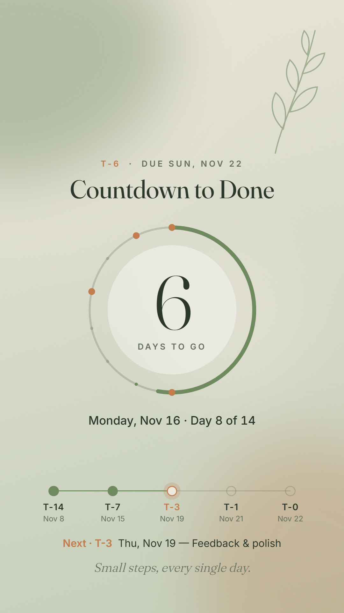
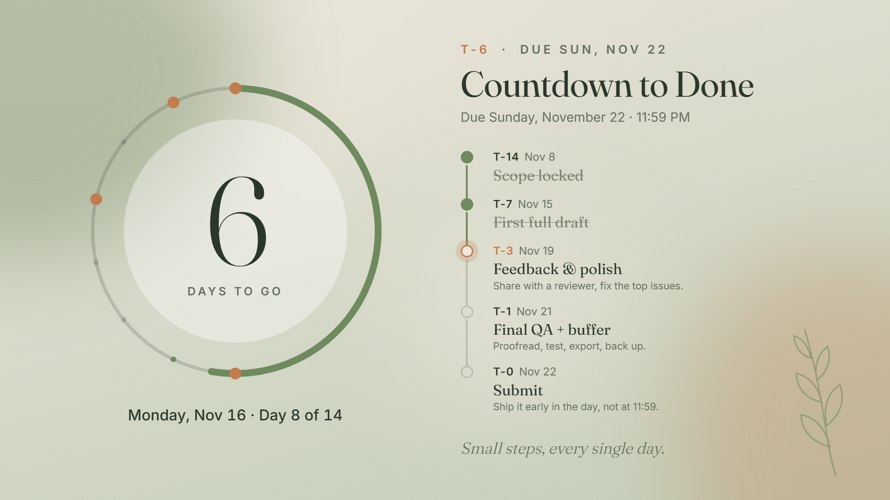
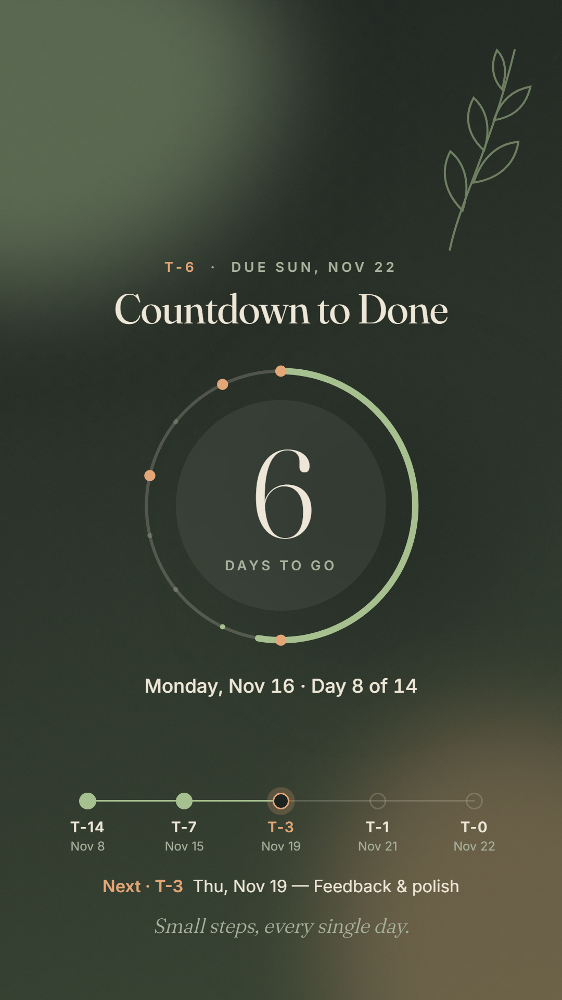
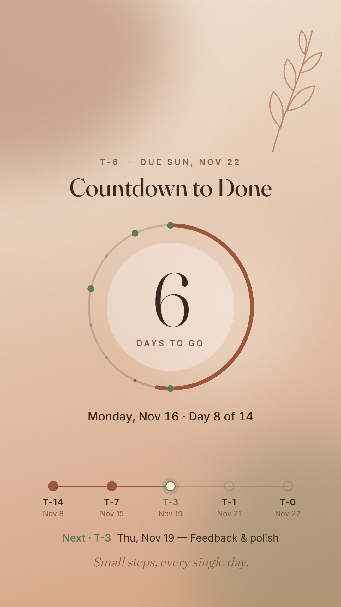

# Countdown to Done

A calm lock screen for my November 22 deadline.

<p align="center">
  
</p>



## About

November is a crowded month for me, with coursework, project work, interviews and this challenge all competing for time. Instead of trying to track everything at once, I picked the one deadline I can't move, my **Final Project Submission on November 22**, and built a system around it.

### Planning backward

I started at the deadline and worked back. I split the last 14 days into five T-minus checkpoints, each with a clear definition of "done":

- **T-14 (Nov 8): Scope locked.** The deliverable, success criteria and full task list are written down.
- **T-7 (Nov 15): First full draft.** A rough version of every part exists, with nothing left blank.
- **T-3 (Nov 19): Feedback & polish.** A reviewer has seen it and I'm fixing the top issues.
- **T-1 (Nov 21): Final QA + buffer.** Proofread, tested, exported and backed up.
- **T-0 (Nov 22): Submit.** Early in the day, with 11:59 PM kept as an emergency buffer.

Each day in the final week also gets one main focus, so I know exactly what matters when I sit down. I listed the main risks too, like a reviewer replying late or upload problems, and planned a buffer for each.

### Designing the lock screen

A plan only helps if I see it, so I turned it into a lock screen I notice every time I pick up my phone. I wanted it to feel natural and modern, calm rather than stressful. It uses a sage green and warm sand gradient, a terracotta accent, a line-drawn leaf sprig and a light paper texture. Big serif numbers show the days left, inside a progress ring that fills as the 14-day window passes. Below it, a checkpoint track shows what's done and what's next, with a short motivation line that changes each day.

I kept the top quarter of the phone screen clear so the phone's clock never covers anything. I made two formats, **9:16 for phone** and **16:9 for laptop**, in three color themes (Sage, Dusk and Clay). I also made a daily wallpaper pack from T-6 to T-0, so the screen updates as the deadline gets closer.

### Staying on track

To make the plan stick, I set up a **daily 9 AM reminder** that tells me that day's task and reminds me to swap in the new wallpaper. There is also a final alert two hours before the deadline.

### What I learned

Working backward from a fixed date turns a vague goal into concrete steps. Seeing the countdown every time I unlock my phone keeps the deadline in view without effort.

## Themes

| Sage | Dusk | Clay |
|---|---|---|
|  |  |  |

## What's in the repo

```
02_Lock_Screen/lockscreen.html        live countdown lock screen (phone + laptop)
03_Reminders/countdown_reminders.ics  daily 9 AM reminders, T-6 to T-0
screenshots/                          lock screens in 3 themes, plus daily/ T-6 to T-0 wallpapers
tools/build.py                        re-renders screenshots and reminders
tools/make_upload.py                  builds JPGs + a PDF for submission
```

## Use it

Open `02_Lock_Screen/lockscreen.html` in a browser. You can change it with URL parameters:

```
lockscreen.html?mode=phone&theme=sage
lockscreen.html?mode=laptop&theme=dusk
lockscreen.html?title=My%20Deadline&deadline=2026-12-05T17:00
```

Add `&static=1` for a still wallpaper with no ticking seconds. To regenerate every screenshot and the reminder file, run `python tools/build.py`. It needs Chrome or Edge installed.

To add the reminders, import `03_Reminders/countdown_reminders.ics` into Google Calendar, Outlook or Apple Calendar.
